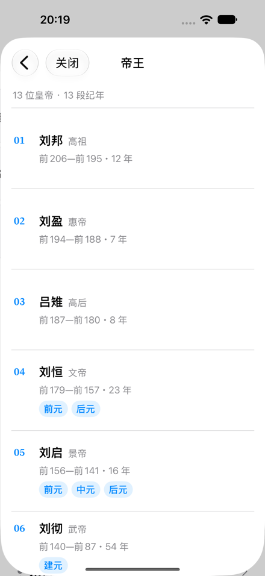
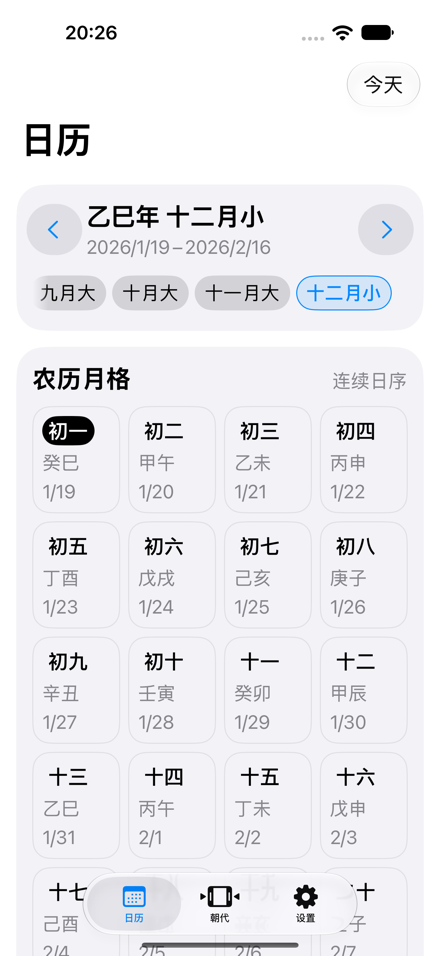

# 统一页面构建方法：Simulator 交互证据

- 日期：2026-10-19；交互基于 `b33df5e9` 加本次实现，代码状态和环境见 [automatic-checks.json](automatic-checks.json)。提交前同步 `e4768959` 后仅重跑自动检查，未重跑交互。
- `device-interaction` 专用子代理通过原生 Xcode MCP 安装并操作当前实现，未修改源码。
- Simulator 保留已安装的完整日期数据；未清空数据、执行下载或替换实际容器。

## 已实际完成

| 路径 | 观察结果 | 层级记录节点 |
| --- | --- | --- |
| 朝代列表 → 西汉 → 返回 | 详情显示 13 位皇帝、43 个年号、213 年；返回朝代列表 | `03-history-push-han`、`04-history-back` |
| 西汉长按菜单 → sheet → 皇帝列表 | sheet 根页读取真实数据，内部 push 后显示刘邦、刘盈、吕雉等记录 | `06-history-sheet-data`、`07-history-sheet-push` |
| 年份选择 2026 → 2025 | 自动关闭，日历显示乙巳年十二月及对应日期 | `09-year-picker-settled`、`11-year-selection-return` |
| 重开年份选择 → 关闭 | 2025 仍被选中，关闭返回日历 | `12-year-picker-reopen` |
| 切换设置 | 显示已安装完整日期数据 | `13-settings-root` |

上述节点完整层级保存在 [runtime-hierarchies.txt](runtime-hierarchies.txt)。已观察的稳定页面未见文字重叠、异常裁切或空数据。

模态内 push 后的真实皇帝数据：

年份选择回传后的日历：

## 工具阻碍与未验证项

原生会话在 sheet push 后返回 `Session not found`，重抓仍失败。重建一次会话后完成年份选择；切换设置并尝试调试入口后会话再次丢失。两次结束会话均返回 `Session doesn't exist anymore`。

随后核对第三方 XcodeBuildMCP 的 project、scheme、simulator 与共享配置一致。其 snapshot 显示系统主屏；点击 App 图标返回 `UI action succeeded, but the refreshed runtime snapshot did not settle before timeout`，重抓仍为主屏，因此结束重试并释放设备。原生最后成功采集的 App 状态均为 Running；这些工具错误不能直接证明 App 崩溃。

本轮未完成西汉 sheet 内 pop/关闭、full-screen、嵌套模态返回、多 Tab 下载演示及子详情。真实容器切换也未执行，其环境和查询行为只由自动测试覆盖。不得用首次迁移版本的截图补作本轮通过证据。

## 运行警告

切换历史和设置 Tab 时记录到 `Update NavigationRequestObserver tried to update multiple times per frame`，原始时间与日志见 [runtime-warning.txt](runtime-warning.txt)。历史导航在警告后仍成功完成。该警告的触发条件、是否属于此次改动、是否与会话丢失有关均尚未确认，保留为后续诊断项。

## 自动测试的边界

[initial-selected-tests.txt](initial-selected-tests.txt) 是首次 289 项全量测试中的宿主、环境与业务呈现测试摘录。之后仅补强了环境测试的 `@Query` 断言；[store-environment-tests.txt](store-environment-tests.txt) 是最终 3 项定向复验，均通过。

提交前同步到 `e4768959` 后，全量 289 项再次全部通过，包含补强后的查询断言；相关测试摘录见 [final-selected-tests.txt](final-selected-tests.txt)。

ImageRenderer 测试会报告无法扁平渲染 UIKit alert 宿主，测试只验证已执行页面的环境和查询结果，不把它当成 alert 或真实 sheet 转场的视觉证据。
